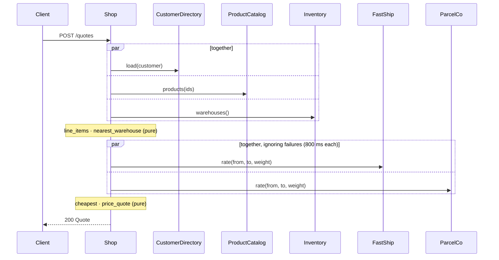
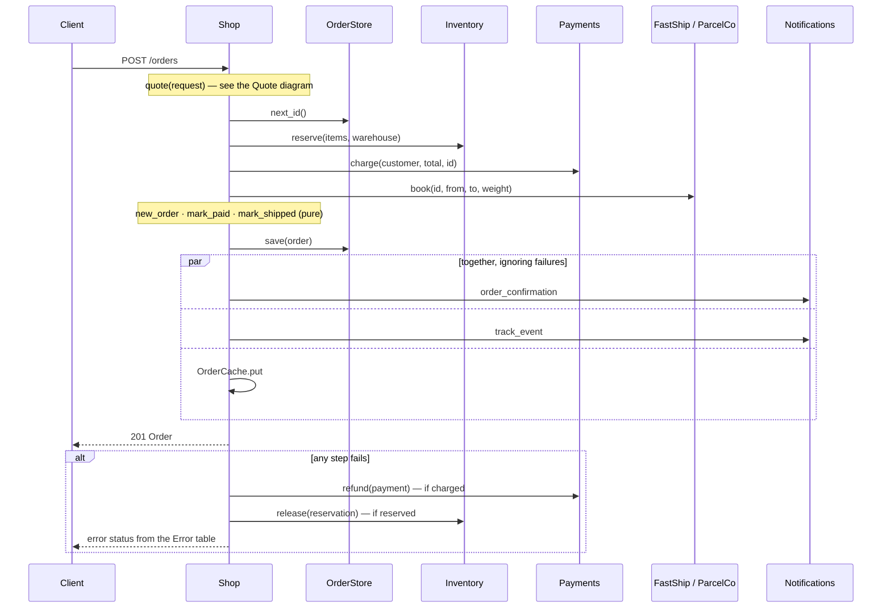

# Checkout

The workflows behind the shop's HTTP routes. Workflows are written as lists:

| Markdown | Means |
|---|---|
| Numbered list `1.` `2.` `3.` | Steps run **in sequence**, each after the one before |
| Bulleted list under **Together** | Calls run **in parallel** |
| `` `name = call(...)` `` | Run the call and keep its result as `name` |
| Text after `—` | A comment |

## Uses

- [Catalog](catalog.mgt.md)
- [Customers](customers.mgt.md)
- [Geography](geo.mgt.md)
- [Orders](orders.mgt.md)
- [Integrations](integrations.mgt.md)

## Request and response types

### `CartItem`

| Field | Type | Constraint |
|---|---|---|
| `product` | `ProductId` | |
| `qty` | `Int` | between 1 and 1000 |

### `QuoteRequest`

| Field | Type | Constraint |
|---|---|---|
| `customer` | `CustomerId` | |
| `items` | `List of CartItem` | at least 1 |

### `Quote`

| Field | Type | Constraint |
|---|---|---|
| `customer` | `CustomerId` | |
| `email` | `Text` | |
| `items` | `List of LineItem` | at least 1 |
| `subtotal` | `Money` | at least $0 |
| `discount` | `Money` | at least $0 |
| `tax` | `Money` | at least $0 |
| `shipping` | `Money` | at least $0 |
| `total` | `Money` | at least $0 |
| `carrier` | `Carrier` | |
| `delivery_days` | `Int` | |
| `warehouse` | `WarehouseId` | |
| `ship_from` | `GeoPoint` | |
| `ship_to` | `GeoPoint` | |
| `weight_kg` | `Decimal` | |

### `OrderDetails`

| Field | Type | Constraint |
|---|---|---|
| `order` | `Order` | |
| `tracking` | `Tracking` | optional |

### `CustomerSummary`

| Field | Type | Constraint |
|---|---|---|
| `name` | `Text` | |
| `discount` | `Percent` | |
| `open_orders` | `Int` | at least 0 |
| `lifetime_spend` | `Money` | at least $0 |
| `shipments` | `List of Tracking` | |

## Pricing rules

These are pure, so they're instant, testable without stubs, and explainable with
`?explain=true`.

| Rule | Returns | Formula |
|---|---|---|
| `nearest_warehouse(warehouses: List of Warehouse, to: GeoPoint)` | `Warehouse` | `the w in warehouses with smallest distance_km(w.location, to) or fail with NoWarehouseAvailable` |
| `cheapest(rates: List of ShippingRate)` | `ShippingRate` | `the r in rates with smallest r.price or fail with NoCarrierAvailable` |

### rule `line_items(products: List of Product, cart: List of CartItem) -> List of LineItem`

Joins two lists and builds a record per match. This is clearer as code than as a
table, so it stays an `mgt` block.

```mgt
LineItem(product: p.id, name: p.name, category: p.category,
         unit_price: p.list_price less bulk_discount(c.qty),
         qty: c.qty, weight_kg: p.weight_kg)
  for each c in cart, for each p in products where p.id is c.product
```

> [!TIP]
> No runtime checks are needed here. `CartItem.qty` has the same `between 1 and 1000`
> constraint as `LineItem.qty`, and a discounted price can't go below $0, so the
> compiler can prove every `LineItem` constraint holds.

### rule `price_quote(customer: Customer, items: List of LineItem, at least 1, warehouse: Warehouse, rate: ShippingRate) -> Quote`

Builds a `Quote` one field at a time, like a spreadsheet. A row can use the fields
above it.

| Field | Value |
|---|---|
| `customer` | `customer.id` |
| `email` | `customer.email` |
| `items` | `items` |
| `subtotal` | `sum of item.line_total() for each item in items` |
| `discount` | `subtotal * customer.discount()` |
| `tax` | `sum of (item.line_total() less customer.discount()) * tax_rate(customer.region, item.category) for each item in items` |
| `shipping` | `rate.price` |
| `total` | `subtotal - discount + tax + shipping` |
| `carrier` | `rate.carrier` |
| `delivery_days` | `rate.days` |
| `warehouse` | `warehouse.id` |
| `ship_from` | `warehouse.location` |
| `ship_to` | `customer.location` |
| `weight_kg` | `sum of item.weight_kg * item.qty for each item in items` |

### rule `new_order(id: OrderId, q: Quote, at: DateTime) -> Order`

| Field | Value |
|---|---|
| `id` | `id` |
| `customer` | `q.customer` |
| `items` | `q.items` |
| `total` | `q.total` |
| `carrier` | `q.carrier` |
| `status` | `Placed` |
| `placed_at` | `at` |

## Workflows

### Quote

#### workflow `quote(request: QuoteRequest) -> Quote`

Price a cart for a customer: the products, their tax, the customer's discount, and the
cheapest carrier from the nearest warehouse.

1. **Together** — three independent lookups, all at once
   - `customer = CustomerDirectory.load(request.customer)`
   - `products = ProductCatalog.products(c.product for each c in request.items)`
   - `warehouses = Inventory.warehouses()`
2. `items = line_items(products, request.items)`
3. **Requires** `items is not empty`, otherwise fail with `UnknownProduct`
4. `warehouse = nearest_warehouse(warehouses, customer.location)`
5. `weight = sum of item.weight_kg * item.qty for each item in items`
6. `rates =` **together, ignoring failures, each within 800 milliseconds** — ask both carriers; `rates` is the list of answers that arrived in time
   - `FastShip.rate(warehouse.location, customer.location, weight)`
   - `ParcelCo.rate(warehouse.location, customer.location, weight)`
7. **Returns** `price_quote(customer, items, warehouse, cheapest(rates))`

<!-- mgtc:diagram quote -->


With `?explain=true` the response also carries the reasoning, built from the rules
the workflow called:

```json
{
  "result": { "subtotal": "24.00", "discount": "2.40", "tax": "1.08", "shipping": "4.50", "total": "27.18", "carrier": "ParcelCo" },
  "explanation": {
    "rule": "price_quote",
    "steps": [
      { "rule": "Premium.discount", "source": "customers.mgt.md:47", "matched_row": 1, "inputs": { "tier": "Gold" }, "result": "10%" },
      { "rule": "tax_rate", "source": "catalog.mgt.md:53", "matched_row": 1, "inputs": { "region": "Europe", "category": "Books" }, "result": "5%" },
      { "rule": "cheapest", "inputs": { "FastShip": "9.00", "ParcelCo": "4.50" }, "result": "ParcelCo" }
    ]
  }
}
```

### Checkout

#### workflow `checkout(request: QuoteRequest) -> Order`

Turn a cart into a paid, booked order. The main steps depend on each other, so they
run in sequence. The notifications at the end don't matter for correctness, so they
run in parallel and can't fail the checkout.

1. `q = quote(request)` — price it again on the server; never trust a quote from the client
2. `id = OrderStore.next_id()`
3. `reservation = Inventory.reserve(q.items, q.warehouse)`
4. `payment = Payments.charge(q.customer, q.total, id)`
5. **When** `q.carrier` **is**
   - `FastShip`: `shipment = FastShip.book(id, q.ship_from, q.ship_to, q.weight_kg)`
   - `ParcelCo`: `shipment = ParcelCo.book(id, q.ship_from, q.ship_to, q.weight_kg)`
6. `order = new_order(id, q, now())`
7. `mark_paid(order, payment)`
8. `mark_shipped(order, shipment)`
9. `OrderStore.save(order)`
10. **Together, ignoring failures** — best effort: a failed email must not fail the checkout
    - `Notifications.order_confirmation(order, q.email)`
    - `Notifications.track_event("order_placed", order.id)`
    - `OrderCache.put(order)`
11. **Returns** `order`

**If it fails** — undo in reverse order; each step is undone only if it actually ran

- `if payment is set then Payments.refund(payment)`
- `if reservation is set then Inventory.release(reservation)`

<!-- mgtc:diagram checkout -->


### Order details

#### workflow `order_details(id: OrderId) -> OrderDetails`

1. `order =` **first of** — hedged read: the cache usually wins, and a miss fails fast so the database answers
   - `OrderCache.get(id)`
   - `OrderStore.load(id)`
2. `tracking = if order.shipment is set then track(order.carrier, order.shipment)` — no shipment, no tracking (optional)
3. **Returns** `OrderDetails(order: order, tracking: tracking)`

### Cancel an order

#### workflow `cancel_order(id: OrderId) -> Order`

1. `order = OrderStore.load(id)`
2. `was_paid = order.status is Paid`
3. `cancel(order)`
4. **Together** — the refund and the save don't depend on each other
   - `if was_paid and order.payment is set then Payments.refund(order.payment)`
   - `OrderStore.save(order)`
5. `OrderCache.forget(id)`
6. **Returns** `order`

### Customer summary

#### workflow `customer_summary(id: CustomerId) -> CustomerSummary`

Lists are the normal way to write a workflow, but an `mgt` block works too and parses to
the same thing. This one is a block because the fan-out and the result record read
better as continuous code.

```mgt
together
  let customer = CustomerDirectory.load(id)
  let orders   = OrderStore.recent_for(id, 20)

-- One tracking call per shipped order, with at most 5 in flight at a time
let shipments = track(o.carrier, o.shipment)
                  for each o in orders where o.status is Shipped and o.shipment is set,
                  together, at most 5 at a time

CustomerSummary(name: customer.name,
                discount: customer.discount(),
                open_orders: count of o in orders where o.is_open(),
                lifetime_spend: sum of o.total for each o in orders where o.status is not Cancelled,
                shipments: shipments)
```

## Examples

Stubs replace services, so workflows can be tested without a network.

| Fixture | Value |
|---|---|
| `ada` | `Premium(id: 7, name: "Ada", email: "ada@example.com", region: Europe, location: GeoPoint(lat: 48.8566, lon: 2.3522), tier: Gold)` |
| `dune` | `Product(id: 1, name: "Dune", category: Books, list_price: $12.00, weight_kg: 0.4)` |
| `berlin` | `Warehouse(id: 1, name: "Berlin", location: GeoPoint(lat: 52.52, lon: 13.405), region: Europe)` |
| `cart` | `QuoteRequest(customer: 7, items: [CartItem(product: 1, qty: 2)])` |

### Stubs: `happy_path`

| Call | Returns |
|---|---|
| `CustomerDirectory.load` | `ada` |
| `ProductCatalog.products` | `[dune]` |
| `Inventory.warehouses` | `[berlin]` |
| `FastShip.rate` | `ShippingRate(carrier: FastShip, price: $9.00, days: 1)` |
| `ParcelCo.rate` | `ShippingRate(carrier: ParcelCo, price: $4.50, days: 4)` |
| `OrderStore.next_id` | `100` |
| `Inventory.reserve` | `Reservation(id: "r-1", warehouse: 1, expires_at: 2026-10-07T12:00Z)` |
| `Payments.charge` | `PaymentId("pay-1")` |
| `ParcelCo.book` | `ShipmentId("ship-1")` |

### Scenarios

| Scenario | Given | Expect |
|---|---|---|
| the cheaper carrier wins | `happy_path` | `quote(cart).carrier is ParcelCo`, `quote(cart).total is $27.18` |
| if one carrier is too slow, the other is used | `happy_path`, `ParcelCo.rate takes 2 seconds` | `quote(cart).carrier is FastShip` |
| a declined card releases the stock and books nothing | `happy_path`, `Payments.charge fails with Declined` | `checkout(cart) fails with Declined`, `Inventory.release was called once`, `ParcelCo.book was not called` |
| a failed confirmation email doesn't fail the checkout | `happy_path`, `Notifications.order_confirmation fails` | `checkout(cart).status is Shipped` |
